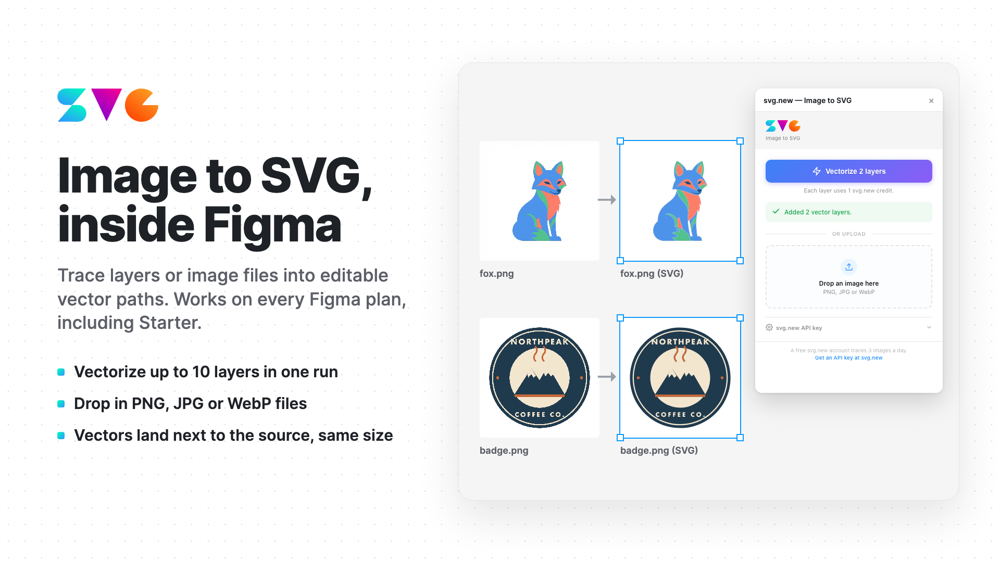

# svg.new for Figma

Trace images and layers into SVG vectors in Figma with [svg.new](https://svg.new).



## Features

- **Vectorize the selection.** Select one or more layers, up to 10 at a time, and click Vectorize. Each SVG is added next to its source layer, at the same size.
- **Upload images.** Drop a PNG, JPG or WebP file on the panel, or click to choose one. The SVG is added in the middle of the view.
- **Full color.** Colors are traced, not only black and white.
- **Editable vectors.** Results are Figma vector layers you can edit like any other.

It works on every Figma plan, including Starter.

## Setup

1. Install the plugin from the Figma Community.
2. Get an API key at [svg.new/account](https://svg.new/account). A free account traces 1 image a day.
3. Paste the key into the plugin panel. It is saved on this computer with Figma's client storage.

Each traced layer or image uses 1 svg.new credit.

## Build

```sh
npm install
npm run build   # compiles code.ts to code.js
```

## Links

- [svg.new](https://svg.new): web app
- [Pricing](https://svg.new/pricing): plans and API credits
- [API docs](https://svg.new/developers): REST API reference
